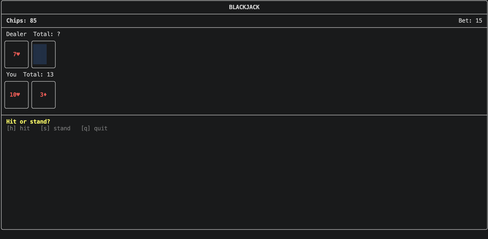

# P01 - Blackjack

**Game chosen:** Blackjack (dealer stands on all 17s, natural pays 3:2).

## Build and run

```
cmake -S . -B build
cmake --build build
./build/game          # FTXUI terminal UI
./build/game --text   # plain cout/cin version
./build/game --test   # rule tests, prints PASS/FAIL
```

## Screenshot



## TUI controls

- Betting: Left/Right change the bet, Enter deals
- Player turn: `h` hit, `s` stand
- Round over: Enter for the next round
- `q` quits anywhere

## Design

- `Blackjack` (game class): no I/O, private data, const getters, and a `Phase` enum that enforces turn order. Calls that aren't allowed in the current phase return `false` and change nothing.
- `Hand` owns a `std::vector<Card>` (composition) and computes value, soft and natural.
- `ConsoleView` and `TuiView` derive from `GameView`. `main` holds a `std::unique_ptr<GameView>` and calls `run()`.
- The hole card is hidden only when `dealerHoleHidden()` says so.

## Tests

`./build/game --test` runs all rule tests and prints PASS/FAIL for each. All tests pass.

## What doesn't work / known issues

- None that I found. The TUI needs a reasonably tall terminal window, otherwise the cards get squashed.

## Changes to Card / Deck

None.